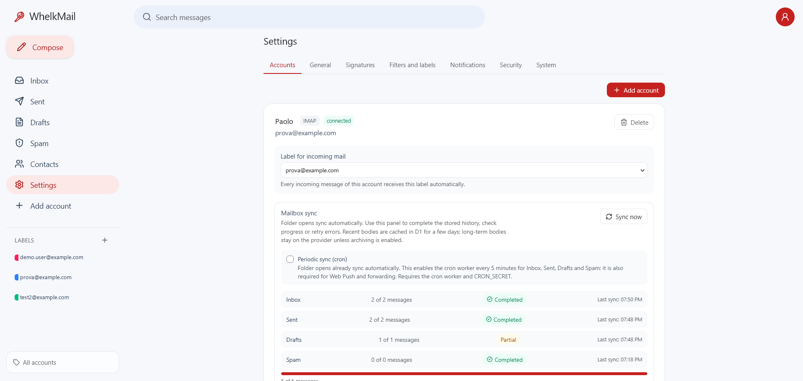
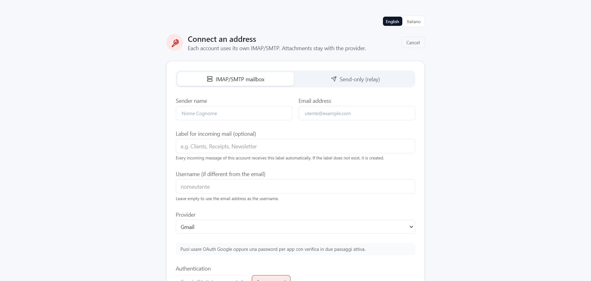

# Getting started

## Requirements

- Node.js 22 or newer and npm.
- A Cloudflare account for deploying (see [Deployment](deployment)).
- An IMAP/SMTP mailbox you already own, or a relay provider account for a send-only domain.

## Local setup

```bash
npm install
cp wrangler.toml.example wrangler.toml
npm run db:init:local
```

The example `wrangler.toml` uses a placeholder D1 ID; for local development that is fine. For a real deployment, create your own database and replace it, or configure the `DB` binding in the Pages dashboard.

If you already have a local database created before labels/signatures, run `npm run db:migrate:local`. If you only need the security tables (sessions, rate limiting, OAuth state), start from that migration with `node scripts/migrate.mjs local --from=012`; existing sessions are invalidated.

## Environment file

Create `.dev.vars` in the project root (it is gitignored):

```env
APP_PASSWORD=change-me
TOKEN_ENC_KEY=<32-byte base64 key>
```

Generate the key with:

```bash
node -e "console.log(require('crypto').randomBytes(32).toString('base64'))"
```

## Run the app

Start the frontend and the API in two terminals:

```bash
npm run dev       # Vite on http://localhost:5173
npm run dev:api   # Pages Functions on http://localhost:8788
```

Open `http://localhost:8788` and sign in with `APP_PASSWORD`. The Functions proxy the Vite dev server, so always use port 8788.

## Connect your first account

1. Sign in with `APP_PASSWORD` (plus the TOTP code if you enabled two-factor authentication).
2. Click **Add account** in the sidebar or in Settings.
3. Choose **IMAP/SMTP mailbox** or **Send-only (relay)**.
4. For an IMAP mailbox:
   - Pick a provider preset or enter IMAP/SMTP hosts, ports and security manually.
   - Choose OAuth where supported, or enter a password / app password.
   - Use **Test connection** in Settings.
5. For a send-only domain:
   - Select the relay provider and paste its API key.
   - Choose where sent copies and drafts go: **Google Drive**, **R2** (only if the `BUCKET` binding exists) or **another account's mailbox**.
6. Send a test message.

| Account settings | Connect an address |
| --- | --- |
|  |  |

## Authentication per provider

| Provider | Method |
|---|---|
| Google accounts | OAuth2 (recommended) or app password (2-Step Verification required) |
| Outlook / Microsoft 365 | OAuth2 + XOAUTH2 (basic auth is no longer supported by Microsoft) |
| Yahoo | App password |
| iCloud | App-specific password |
| Generic IMAP | Account password or app password |
| Relay accounts | Provider HTTP API key (+ secret/domain where required) |

OAuth application setup is covered in [OAuth setup](oauth).

## First checks

- Save a draft, reopen it from **Drafts**, and delete it.
- Add a second account to see address labels and the unified inbox.
- Confirm that a sent message appears in the provider's Sent folder.

## Next steps

- [Deployment](deployment) — run it on Cloudflare.
- [Configuration](configuration) — all bindings, secrets and variables.
- [PWA and Web Push](pwa-push) — install the app and enable notifications.
