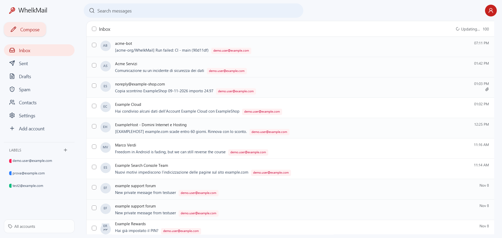

# WhelkMail documentation

**Your mailboxes. Your domain. One calm inbox.**

WhelkMail is a self-hosted webmail client for the IMAP and SMTP accounts you already own. It runs entirely on Cloudflare Pages and Workers, so there is no mail server to operate and no infrastructure to babysit.

Connect Gmail, Outlook, iCloud, Fastmail, Yahoo or a custom domain and get a familiar, Gmail-style interface on top of the mailboxes you already use. Messages, sent copies, drafts and attachments stay on your provider; only a short-lived D1 cache and the strictly opt-in long-term archive copy them.

> **WhelkMail is not a mail server.** It talks IMAP and SMTP to the providers you already trust.

## Why WhelkMail

- **One inbox, many accounts.** Gmail, Outlook, iCloud, Yahoo and custom domains side by side, with colored account labels and a shared address book.
- **Cloudflare-native.** Pages Functions, D1, R2 and `cloudflare:sockets`: no VPS, no container, no mail server to patch.
- **Your data stays put.** By default the client reads from the provider. A short-lived D1 cache keeps recently listed or opened bodies for fast opens; the long-term archive on R2 or Google Drive remains strictly opt-in.
- **Privacy by default.** HTML email is rendered in a sandboxed frame, remote images and tracking pixels stay blocked unless you enable them, and credentials are encrypted at rest.
- **Actually yours.** Self-hosted, MIT licensed, no telemetry, no vendor account required beyond your Cloudflare project.

## What you get

### Inbox experience

- Message list with a full-width reading view or an optional right-side reading pane, plus Gmail-style multi-select for delete, move and spam actions.
- Inbox, Sent, Drafts and Spam with autosave and reopenable drafts.
- Gmail-style conversations using RFC `References` when available and a subject fallback otherwise.
- HTML bodies in a sandboxed frame with optional remote images and attachment indicators from `BODYSTRUCTURE`.
- Installable PWA, mobile drawer layout and Web Push notifications with per-account/folder preferences.
- English by default, Italian available; the dictionary is extensible.

### Accounts and sending

- Multiple accounts in one view, each with its own IMAP/SMTP servers and credentials.
- Password, app-password, Google OAuth2 and Microsoft OAuth2 (XOAUTH2) authentication.
- Sending through each account's own SMTP server.
- Replies from the right address, including forwarding domains and relay accounts that send from any address on their domain.
- Send-only "relay" accounts for domains without SMTP, with sent copies and drafts stored on Google Drive, Cloudflare R2 or an existing IMAP mailbox.
- Optional archive and provider cleanup for IMAP.

### Organization

- Gmail-style labels shared across all accounts.
- Per-account incoming labels applied automatically.
- Contacts with search, edit, CSV import/export and recipient autocomplete.
- Signatures: one shared signature or a different signature per account.

### Automation

- Gmail-style filters shared across accounts: match From/To/Subject/words/attachments and apply labels and/or forward the original EML.
- Incremental, resumable IMAP metadata sync into D1.
- Optional background sync through the cron worker every 5 minutes.
- Anti-loop forwarding headers, per-filter forward logs and deletion logs.

## Explore the documentation

- [Getting started](getting-started) — run WhelkMail locally and connect your first account.
- [Deployment](deployment) — the complete Cloudflare Pages guide.
- [Configuration](configuration) — bindings, secrets and environment variables.
- [Architecture](architecture) — how the client, Pages Functions, D1 and IMAP/SMTP fit together.
- [Mail flows](mail-flows) — listing, search, reading, sending, replies, threads and drafts.
- [Data model](data-model) — every D1 table and what it stores.
- [Security](security) — authentication, sessions, encryption and hardening.
- [Relay accounts](relay-accounts) — send-only domains and storage destinations.
- [Labels and filters](labels-filters) — shared taxonomy and automatic rules.
- [PWA and Web Push](pwa-push) — installable app and notifications.
- [Forwarding and cleanup](forwarding-cleanup) — filter forwarding and provider deletion.
- [Development](development) — local workflow, database migrations and tests.
- [Upgrading](upgrading) — deploy a new release safely.
- [Troubleshooting](troubleshooting) — common symptoms and fixes.
- [Known limitations](limitations) — what WhelkMail deliberately does not do.

## Stack

- React 19 + Vite 8 + TypeScript + Tailwind CSS
- Cloudflare Pages Functions (Workers runtime)
- Cloudflare D1 for accounts and metadata
- `cloudflare:sockets` for IMAP/SMTP
- Optional Cloudflare R2 or Google Drive for archive
- `postal-mime` for MIME parsing

## License

MIT. See [License](license).
